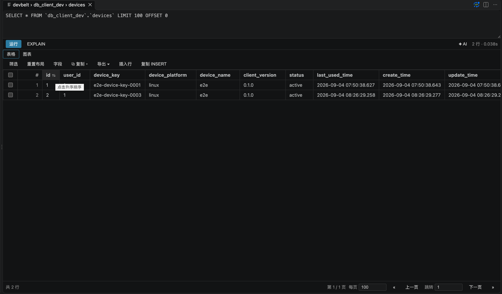
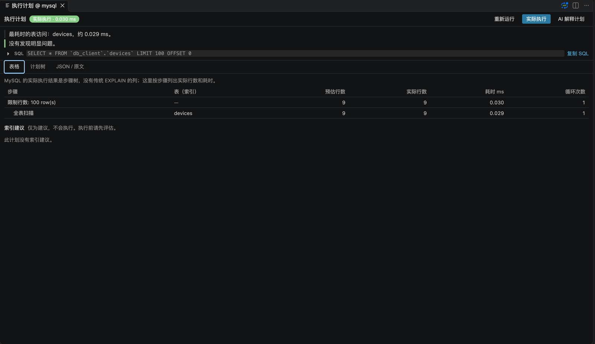
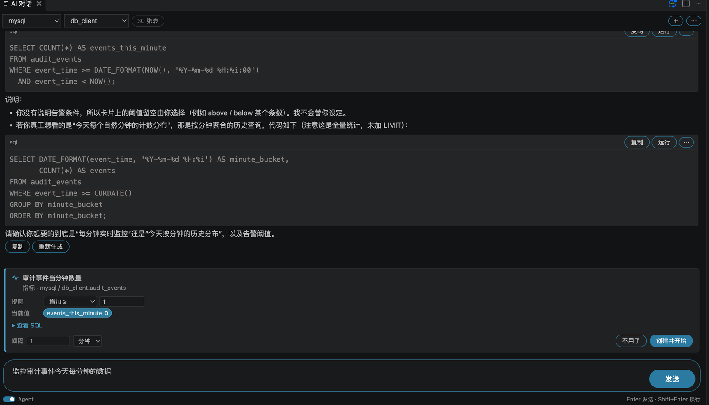
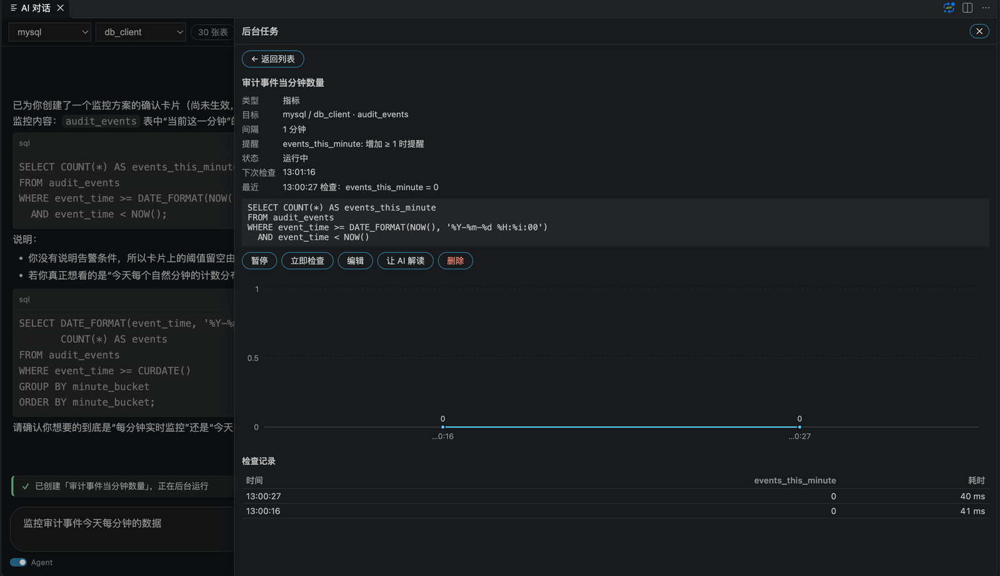
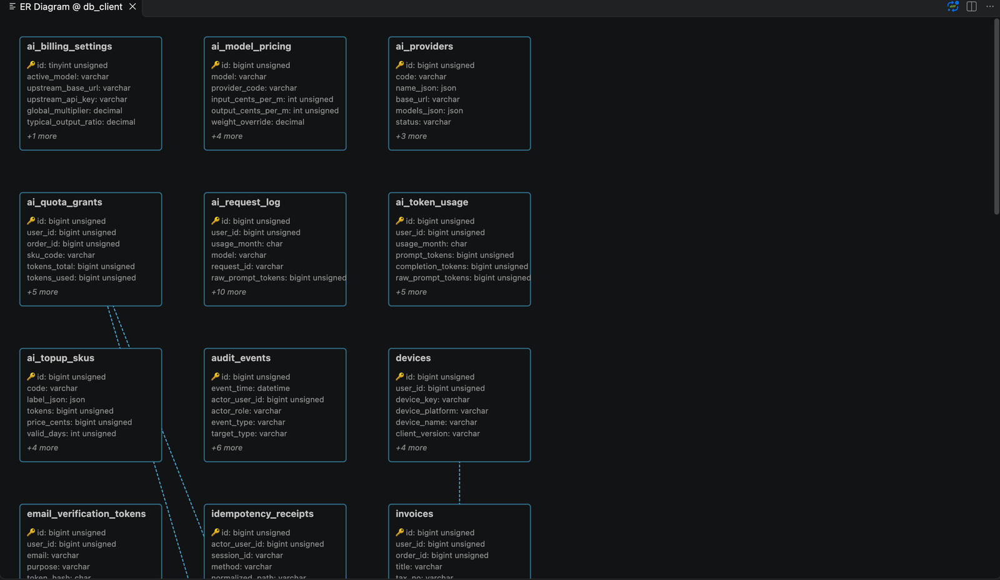
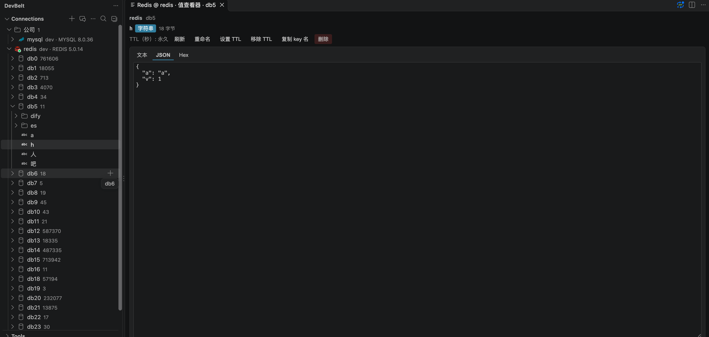
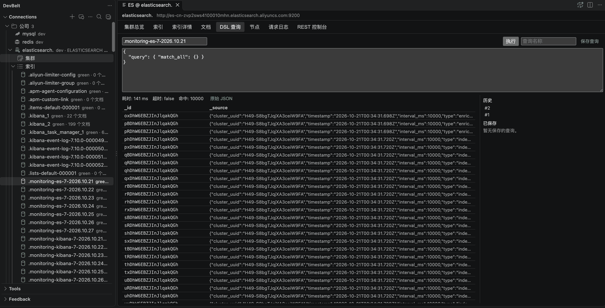
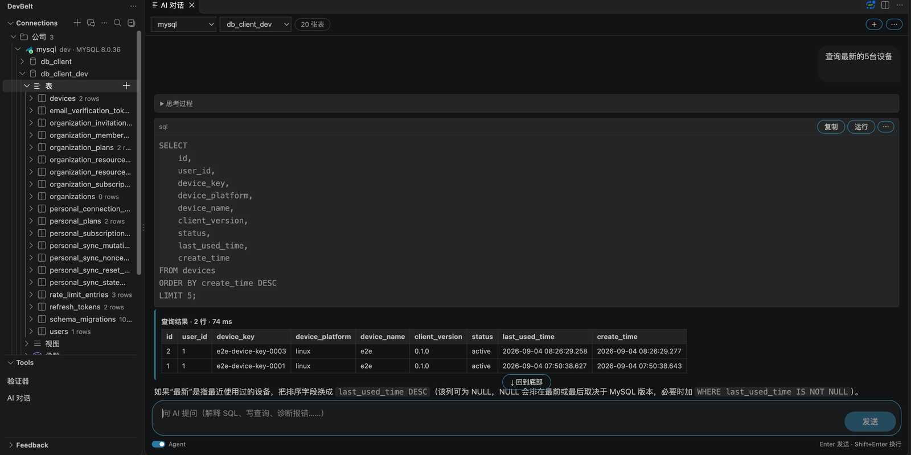

# DevBelt

**Database development, without leaving VS Code.**

DevBelt brings SQL, Redis, Elasticsearch and AI-assisted workflows into one VS Code workspace. Browse connections, write and run queries, edit results, inspect schemas, and diagnose problems without switching between database tools.

**Install**: [VS Code Marketplace](https://marketplace.visualstudio.com/items?itemName=lang2hong.devbelt-db-client) · [Open VSX](https://open-vsx.org/extension/lang2hong/devbelt-db-client) · [Download VSIX](https://github.com/lang2hong/devbelt/releases/latest)

[中文](https://github.com/lang2hong/devbelt/blob/main/README.md) · [Changelog](https://github.com/lang2hong/devbelt/blob/main/CHANGELOG.md)

## Why DevBelt

- **One workspace, multiple engines.** MySQL, PostgreSQL, SQLite, Redis and Elasticsearch share the same workspace, tab model and security model.
- **From query to result.** Run the current statement or selection, cancel long queries, inspect plans, edit result rows and export data.
- **Schema work is first-class.** Table designer, DDL, ER diagrams, schema comparison and PostgreSQL multi-schema/multi-database navigation.
- **AI is part of the workflow.** Generate SQL, explain and optimize queries, diagnose errors, ask questions about result samples and visualize results.
- **Security is built in.** Secrets stay in VS Code `SecretStorage`; SSH tunnels use host-key verification; read-only and production guards are fail-closed; writes are audited.
- **Personal data stays personal.** Optional end-to-end encrypted sync covers connections and groups, saved queries and folders, schema notes, authenticator entries, and AI model access. The server stores ciphertext only.
- **Isolated per account.** Data and secrets are scoped to the signed-in account; switching accounts reloads panels.

## SQL workspace

- Connection groups, connection testing and SSH tunnels.
- SQL editing, context-aware completion, formatting, execution and cancellation.
- `EXPLAIN` from the editor.
- Multi-result grids with filters, sorting, paging and controlled inline editing.
- Query history, audit log, scheduled backups, server dashboard and object search.
- CSV, JSON, XML, XLSX and SQL import/export; database-to-database transfer.

## Query insight

- **Visual EXPLAIN** for MySQL, PostgreSQL and SQLite: plan tree, node details, warning highlights and raw-plan copy. Statements are planned, never executed.
- **AI: Explain plan** sends a compact plan summary to AI Chat.
- **Index suggestions** for flagged tables: column order, confidence, reasons and risks. Copy the DDL; nothing is executed.
- **Slow Queries**: local query history grouped by SQL template, sorted by time or runs.
- **SQL diagnostics** for `UPDATE`/`DELETE` without `WHERE`, `DROP`/`TRUNCATE`/`ALTER`, `NOT IN (subquery)` and other risky patterns.
- **Data dictionary**: export as Markdown or HTML, without connection details.

## Monitoring

- **Scheduled read-only checks**: row count, a numeric metric or new rows; VS Code notification when your condition is met.
- **Propose, not create**: in Agent mode the assistant can only propose a task as a card; you pick the interval and alert condition and confirm before anything runs.
- **Background Tasks**: charts, check history, next check, failure count, and editable interval / condition.

## Schema and data

- Table designer and DDL generation.
- ER diagrams and schema comparison with synchronization SQL.
- PostgreSQL multi-schema writes, DDL, export and data editing.
- PostgreSQL multi-database navigation with lazy per-database sessions.
- Backup/restore and mock-data generation.

## Redis

- Standalone, Cluster and Sentinel connections, including SSH tunnels and TLS.
- Key browser with separators, SCAN paging and binary-safe keys.
- Native editors for strings, hashes, lists, sets, sorted sets and Streams.
- Stream consumer-group details, pending entries, `XACK` and `XCLAIM`.
- CLI console, command log, slow log and server status.
- Read-only mode and dangerous-command confirmation.

## Elasticsearch

- HTTP/HTTPS, Basic/API-key authentication, TLS and SSH tunnels.
- Cluster overview, node list and index browser.
- Mapping, settings and aliases inspection.
- Document browsing, create, edit, delete and bulk delete.
- DSL console and REST console with structured errors and in-flight request cancellation.
- Fail-closed read-only enforcement and audit logging.

## AI assistant

- AI Chat with streaming responses, conversation history and schema context.
- Natural-language to SQL, SQL explanation and optimization, and error diagnosis.
- Data Q&A with sample sending explicitly opt-in.
- Table design generation and review.
- Result charts: bar, line, area, pie, stacked bar and horizontal bar.
- Per-response credits used, duration and trigger time.
- Inline SQL completion (off by default, trigger with `Alt+/`).
- Server proxy or bring-your-own API key.
- **Agent mode** (off by default): inspects the schema, runs read-only SQL and plain `EXPLAIN` step by step, within a step / tool-call / time budget.
- **Write proposals only**: DML and DDL are proposed and executed only after you approve them in a native dialog.
- **Where to open AI Chat**: the DevBelt sidebar title, the status bar, or the `✦ AI` button in a query result panel.

## Sync, security and audit

- Personal connection sync is end-to-end encrypted; the server stores ciphertext only.
- Auto sync is off by default; use Sync Now / Pull / Push or enable it explicitly.
- SSH host-key verification: confirm a new fingerprint by default, `strict` mode trusts only `known_hosts`, and key changes always fail closed.
- Credentials live in VS Code `SecretStorage`.
- Read-only mode, production guards and audit records for writes.
- Authenticator (2FA/TOTP) with secrets kept in the OS keychain.

## Get started

1. Install DevBelt from the VS Code Marketplace.
2. Open the DevBelt activity bar and create a connection.
3. Test the connection, open a SQL editor or browse data.

## Shortcuts

| Shortcut | macOS | Action |
|---|---|---|
| `Ctrl+Enter` | `Cmd+Enter` | Run query or current statement |
| `Ctrl+Alt+Enter` | `Cmd+Ctrl+Enter` | Run in a new panel |
| `Ctrl+Shift+Enter` | `Cmd+Shift+Enter` | Run all statements |
| `Ctrl+Shift+E` | `Cmd+Shift+E` | EXPLAIN |
| `Alt+A` | — | NL2SQL (generate SQL from natural language in SQL editors) |
| `Alt+/` | — | Inline SQL completion (when enabled) |
| `Ctrl+Alt+F` | `Cmd+Alt+F` | Search database objects |
| `Ctrl+Alt+C` | `Cmd+Alt+C` | Search connections |

## Requirements

- VS Code **1.85.0** or newer.
- Supports MySQL, PostgreSQL, SQLite, Redis and Elasticsearch.

## Privacy and telemetry

DevBelt uses anonymous heartbeats to count installs and active installations, **without requiring sign-in**:

- **Install**: reported once, the first time a machine (or VS Code profile) activates the extension.
- **Active**: at most once per day afterwards (multiple launches within the same UTC day count once).

The payload contains a random installation ID, the extension version, OS/architecture, and whether the window is remote. It never contains your email, account, connection details, queries, or IP address.

Heartbeats are controlled by the extension's own `devbelt.telemetry.enabled` setting (default `true`) and can be turned off at any time. On first activation, if VS Code's global telemetry is off, a one-time notice is shown with a **Turn off anonymous stats** action.

## Feedback

Open **Feedback** in the VS Code sidebar to send a bug report, feature request or screenshot, or use [GitHub Issues](https://github.com/lang2hong/devbelt/issues). No sign-in is required; signed-in feedback is linked to your account.

More docs: [Documentation center](https://github.com/lang2hong/devbelt/tree/main/docs) · [Product overview](https://github.com/lang2hong/devbelt) · [Changelog](https://github.com/lang2hong/devbelt/blob/main/CHANGELOG.md)

## License

MIT