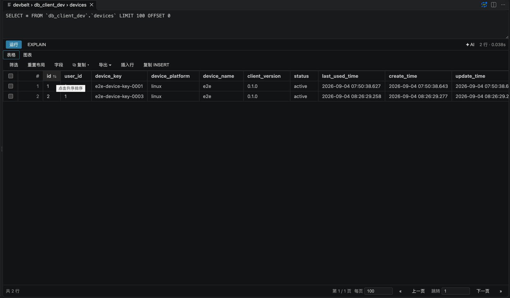
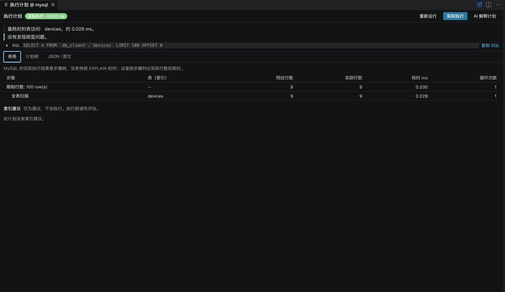
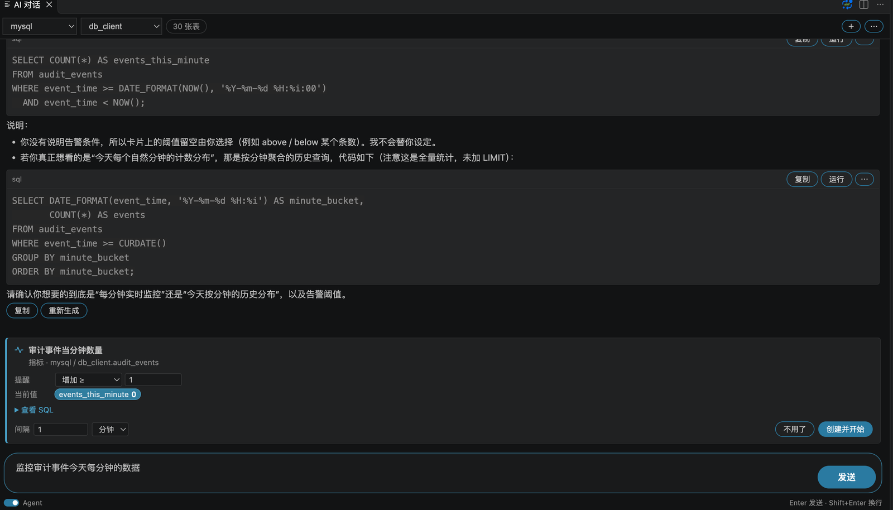
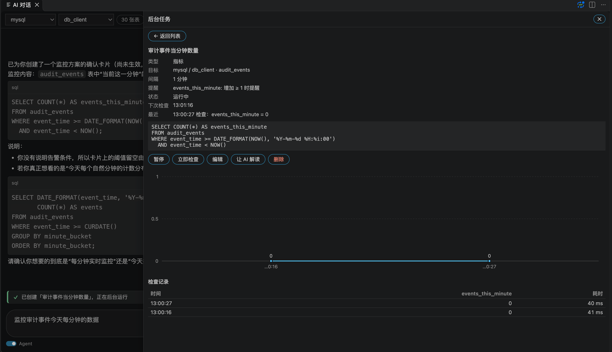
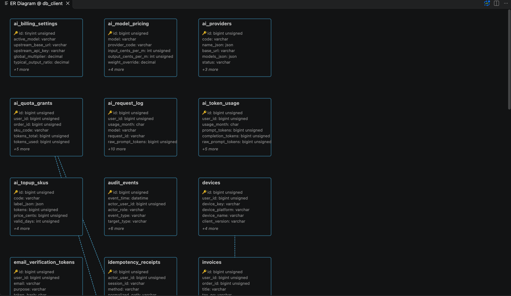
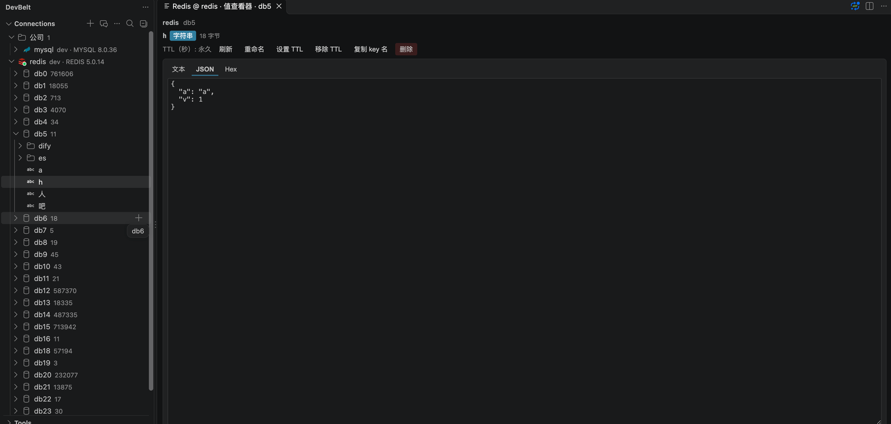
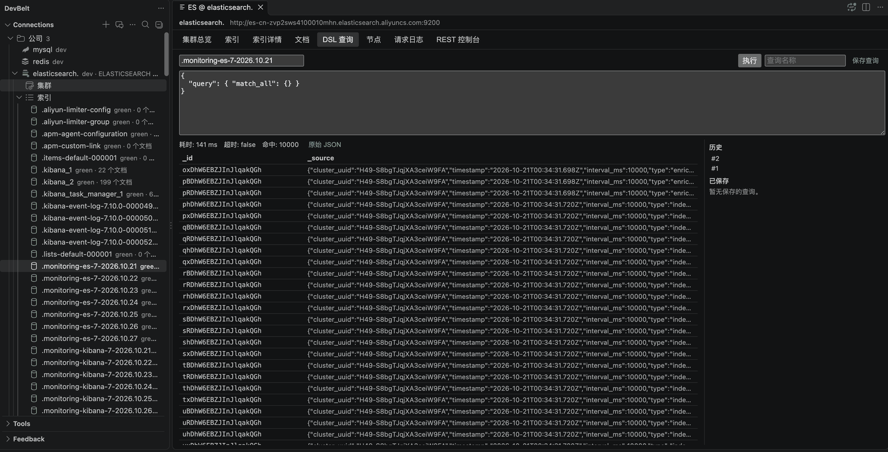
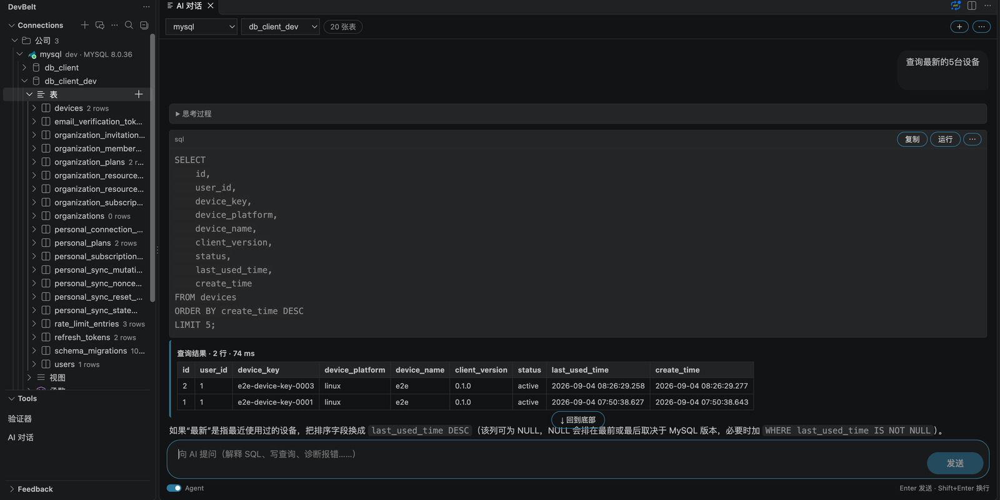

# DevBelt

**在 VS Code 内完成数据库开发。**


DevBelt 将 SQL、Redis、Elasticsearch 与 AI 工作流整合到同一个 VS Code 工作区。浏览连接、编写并执行查询、编辑结果、查看结构、诊断问题，无需在多个数据库工具间切换。

发版说明见 [CHANGELOG.md](https://github.com/lang2hong/devbelt/blob/main/CHANGELOG.md)。English: [README.en.md](https://github.com/lang2hong/devbelt/blob/main/README.en.md)。


### 为什么选择 DevBelt

- **一个工作区，多种引擎。** MySQL、PostgreSQL、SQLite、Redis、Elasticsearch 共用统一的工作区、页签模型与安全模型。
- **从查询到结果。** 执行当前语句或选中 SQL、取消长查询、查看执行计划、编辑结果行并导出数据。
- **结构设计是一等能力。** 表设计器、DDL、ER 图、Schema 对比，以及 PostgreSQL 多 schema、多库导航。
- **AI 融入工作流。** 生成 SQL、解释与优化、错误诊断、基于结果样本的数据问答和结果可视化。
- **安全内建。** 凭据保存在 VS Code `SecretStorage`；SSH 隧道校验主机密钥；只读与生产保护默认 fail-closed；写操作进入审计。
- **个人数据端到端加密。** 可选开启的同步覆盖：连接与分组、保存的查询与文件夹、表/列注记、验证器条目（开启同步时 TOTP 密钥也会加密上传）、AI 模型接入配置。每一类可在 `devbelt.sync.items` 单独关闭；服务端只存密文。
- **按账号隔离。** 数据和凭据按登录账号隔离存储，切换账号时面板会重新加载；若另一个 VS Code 窗口换了登录账号，本窗口会停止同步并提示重新加载窗口。

### SQL 工作台



- 连接分组、连接测试与 SSH 隧道。
- SQL 编辑、上下文补全、格式化、执行与取消。
- 编辑器内 `EXPLAIN`。
- 多结果表格、筛选排序、分页与受控行内编辑。
- 查询历史、审计日志、定时备份、服务器仪表盘与对象搜索。
- CSV、JSON、XML、XLSX、SQL 导入导出与库间数据传输。

### 查询洞察



- **可视化 EXPLAIN**：支持 MySQL（`FORMAT=JSON`）、PostgreSQL（`FORMAT JSON`）、SQLite（`EXPLAIN QUERY PLAN`），提供计划树、节点详情、告警高亮（大表全扫描、filesort、临时表、高风险嵌套循环、缺少索引）与原始计划复制。只执行普通 `EXPLAIN`，语句只做规划、不会执行。PostgreSQL 已在 CI 的 PostgreSQL 16 上做集成测试，真实业务库上的人工走查尚未进行。
- **AI 解释计划**：把精简、有上限的计划摘要发给 AI Chat 解释。
- **索引建议**：只针对计划中有告警的表；按「等值 → 范围 → 排序」组合列，检查已有索引与主键/唯一键，给出置信度、理由与风险。可复制 DDL，不会自动执行。
- **慢查询分析**（`DevBelt: 慢查询分析`）：按 SQL 模板聚合本地查询历史，可按总/平均/最大耗时或次数排序，显示失败次数，一键打开 SQL 或 EXPLAIN。保留条数可用 `devbelt.insights.historyLimit` 调整。
- **SQL 诊断**：`.sql` 编辑器内提示缺少 `WHERE` 的 `UPDATE`/`DELETE`、`DROP`/`TRUNCATE`/`ALTER`、`NOT IN (子查询)`、`SELECT *` 与方言不符的写法；`devbelt.diagnostics.enabled` 总开关，`devbelt.diagnostics.rules` 按规则调整级别。
- **数据字典**：库节点 → 数据 → 生成数据字典，导出 Markdown 或 HTML，不包含任何连接信息。

### 监控



- **定时只读检查**：行数、一个数值指标、或基于已有列的新增行；命中条件时弹 VS Code 通知。
- **只提出、不创建**：Agent 模式下助手只能以卡片形式**提出**任务；你选间隔和提醒条件、确认后才会执行。
- **后台任务**：图表、检查记录、下次检查、失败次数，间隔和条件可编辑。



### 结构与数据



- 表设计器与 DDL 生成。
- ER 图、Schema 对比与同步 SQL。
- PostgreSQL 多 schema 写入、DDL、导出与数据编辑，对象名按 schema 限定。
- PostgreSQL 多库浏览，按库懒建会话。
- 备份/恢复与模拟数据生成。

### Redis



- 单机、Cluster、Sentinel 连接，支持 SSH 隧道与 TLS。
- 键浏览器、分隔符折叠、SCAN 分页（每次「加载更多」默认 2000 个键，`devbelt.redis.keyPageSize`）与二进制安全键。
- 全部核心数据类型原生编辑：string、hash、list、set、zset、Stream。
- Stream 消费组、pending 明细、`XACK` 与 `XCLAIM`。
- CLI 控制台、命令日志、慢日志与服务器状态。
- 只读模式与危险命令确认。

### Elasticsearch



- HTTP/HTTPS、Basic/API Key、TLS 与 SSH 隧道。
- 集群总览、节点列表与索引浏览。
- mapping、settings、aliases 查看。
- 文档 `search_after` 分页浏览，创建、编辑、删除与批量删除。
- DSL 控制台，结果分页并结构化展示。
- REST 控制台，结构化错误、截断提示与在途请求取消。
- 只读 fail-closed 与审计日志。

### AI 助手



- AI Chat 流式回复、会话历史（较早的消息压缩成摘要，不直接丢弃）与 Schema 上下文。
- 自然语言生成 SQL、SQL 解释与优化、错误诊断。
- 数据问答，样本发送需显式确认。
- 表设计生成与审阅。
- 结果图表：柱状图、折线图、面积图、饼图、堆叠柱状图、横向条形图；支持多 Y 轴、标题可编辑、按列聚合。
- 每条回复显示积分消耗、耗时与触发时间。
- SQL 行内补全（默认关闭，按 `Alt+/` 触发）。
- 支持服务端代理或自带 API Key。
- AI 偏好与自定义规则端到端加密跨设备同步。
- **Agent 模式**（默认关闭）：在 AI Chat 选好连接，打开输入框下方的「Agent」开关（监控类请求会自动打开）。助手会逐步查结构、跑只读 SQL 与普通 `EXPLAIN`，并受步数 / 工具次数 / 时间预算限制（默认 12 次 / 24 次 / 120 秒，可用 `devbelt.ai.agent.*` 调整）。
- **写操作只能提出**：DML / DDL 先给出方案，能试执行的先试执行并回滚，只有你在原生弹窗中批准后才会真正执行。`devbelt.ai.agent.allowWrites`、`devbelt.ai.agent.allowDdl`、`devbelt.ai.agent.allowProduction` 控制允许提出哪些；每次决策写入本地 JSONL 执行账本。
- **AI 对话入口**：DevBelt 侧栏标题、状态栏，以及查询结果面板的 `✦ AI` 按钮（只预填当前 SQL，不会自动发送）。
- **EXPLAIN 面板「实际执行」**：在独立只读会话上执行 `EXPLAIN ANALYZE`，获得真实行数与耗时（MySQL / PostgreSQL；生产连接需开启 `devbelt.explain.allowAnalyzeProduction`）。

### 同步、安全与审计

- 个人连接同步端到端加密，服务端只保存密文。
- 自动同步**默认关闭**（`devbelt.sync.autoSync`）；可手动立即同步 / 拉取 / 推送，或显式开启。
- SSH 主机密钥校验：
  - `tofu`（默认）：首次连接确认 SHA256 指纹，接受后信任。
  - `strict`：只信任 `known_hosts` 中已有主机。
  - 密钥变更或 `@revoked` 一律硬失败。
- 凭据保存在 VS Code `SecretStorage`。
- 只读模式、生产保护与写操作审计。
- 验证器（2FA/TOTP）密钥保存在操作系统密钥库。

### 快速开始

1. 从 VS Code 插件市场安装 DevBelt。
2. 打开 DevBelt 活动栏，新建连接。
3. 测试连接，打开 SQL 编辑器或浏览数据。
4. 如需跨设备同步，登录并启用端到端加密个人同步。

```bash
code --install-extension lang2hong.devbelt-db-client
```

### 快捷键

| 快捷键 | macOS | 操作 |
|---|---|---|
| `Ctrl+Enter` | `Cmd+Enter` | 运行查询或当前语句 |
| `Ctrl+Alt+Enter` | `Cmd+Ctrl+Enter` | 在新面板运行 |
| `Ctrl+Shift+Enter` | `Cmd+Shift+Enter` | 运行全部语句 |
| `Ctrl+Shift+E` | `Cmd+Shift+E` | EXPLAIN |
| `Alt+A` | — | NL2SQL（在 SQL 编辑器中用自然语言生成 SQL） |
| `Alt+/` | — | 行内 SQL 补全（启用时） |
| `Ctrl+Alt+F` | `Cmd+Alt+F` | 搜索数据库对象 |
| `Ctrl+Alt+C` | `Cmd+Alt+C` | 搜索连接 |

### 要求与状态

- 需要 VS Code **1.85.0** 或更高版本。
- 本地 SQL 路径（MySQL、PostgreSQL、SQLite）是当前最成熟的部分。
- Redis、Elasticsearch 与 AI 能力已可用，仍在持续进行真机硬化。
- 个人同步为端到端加密、可选启用；双设备安装版验证仍在进行。

### 遥测与安装统计

DevBelt 每天最多发送一次匿名心跳，用于统计安装量和活跃安装数。上报内容只有：随机安装 ID（保存在本机）、扩展版本、操作系统/架构、是否为远程窗口；不包含邮箱、账号、连接信息、查询内容或 IP 地址。服务端仅用请求 IP 做心跳接口的限流，限流桶两小时后清理，不会与安装记录或日志关联。

只有在 VS Code 遥测（`vscode.env.isTelemetryEnabled`）开启且 `devbelt.telemetry.enabled`（默认开启）为 `true` 时才会发送。将 `devbelt.telemetry.enabled` 设为 `false` 即可关闭。我们不统计卸载；安装数按「首次激活」计算。远程/Codespaces 窗口使用独立的扩展宿主，可能被计为单独安装。

### 反馈

侧边栏「反馈」视图把入口并列展示：「写反馈 / 查看回复」（打开面板，带未读徽标），以及 Bug 报告、功能建议、文档、评价。点击「写反馈 / 查看回复」（或命令 `DevBelt: 写反馈 / 查看回复`）会在编辑器区域打开面板，表单、图片附件与「我的反馈与回复」上下排列。可附最多 3 张 PNG/JPEG/WebP/GIF 截图（每张 2 MB），图片保存在 DevBelt 服务端，只有团队能在管理后台查看。反馈无需登录，每条会附带随机安装 ID、扩展版本和操作系统，服务端会记录来源 IP 以处理滥用；登录状态下提交的反馈会关联到你的账号。

DevBelt 团队的回复显示在面板的「我的反馈与回复」中，有新回复时侧边栏图标上会显示未读数。回复在打开视图、打开面板、点击「刷新」或提交反馈时拉取，不是实时推送。匿名反馈的回复通过保存在 VS Code 安全存储中的随机回复凭证与本安装绑定，清除该存储后将无法再查看；登录后提交的反馈随账号可见。如果填写了邮箱，团队也可能同时通过邮件回复。

### 文档

- [产品介绍](https://github.com/lang2hong/devbelt)
- [文档中心](https://github.com/lang2hong/devbelt/tree/main/docs)
- [问题反馈](https://github.com/lang2hong/devbelt/issues)

## 许可

MIT
