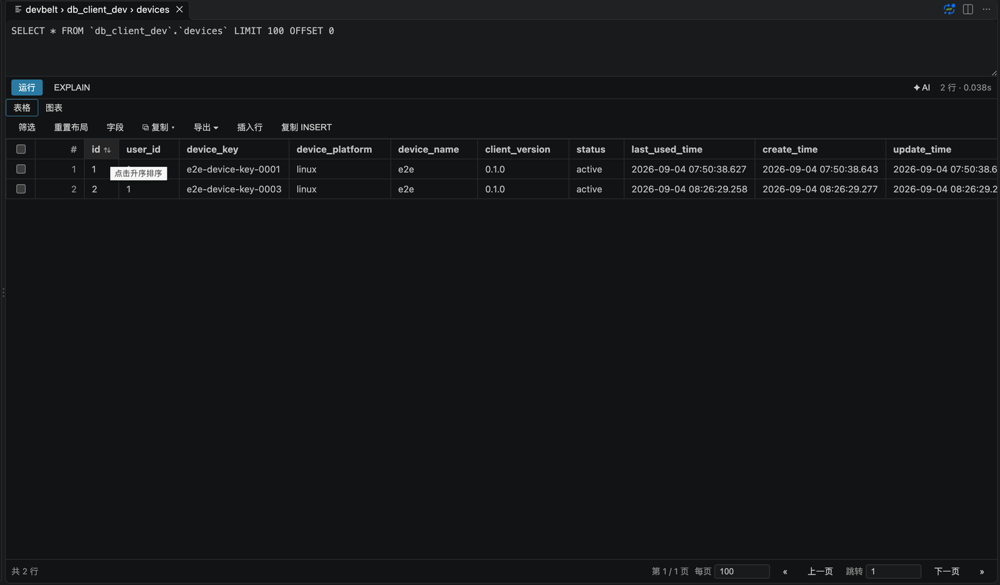
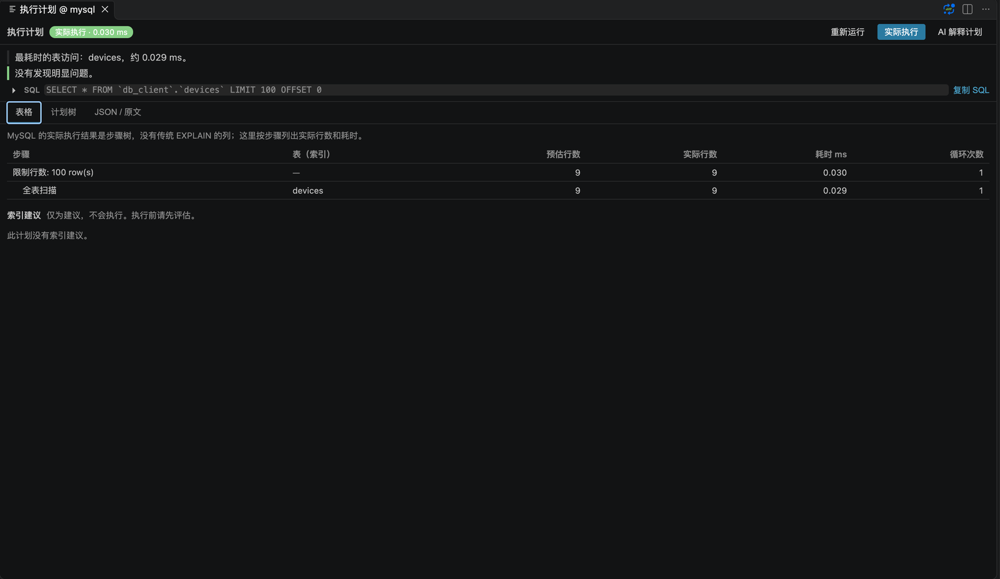
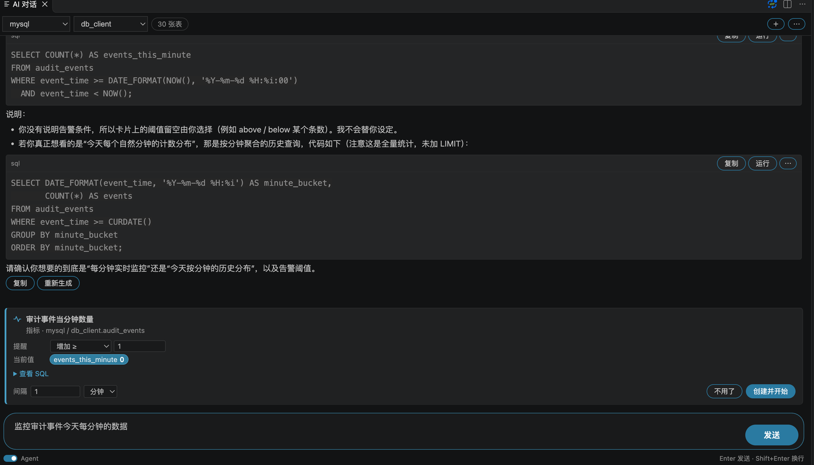
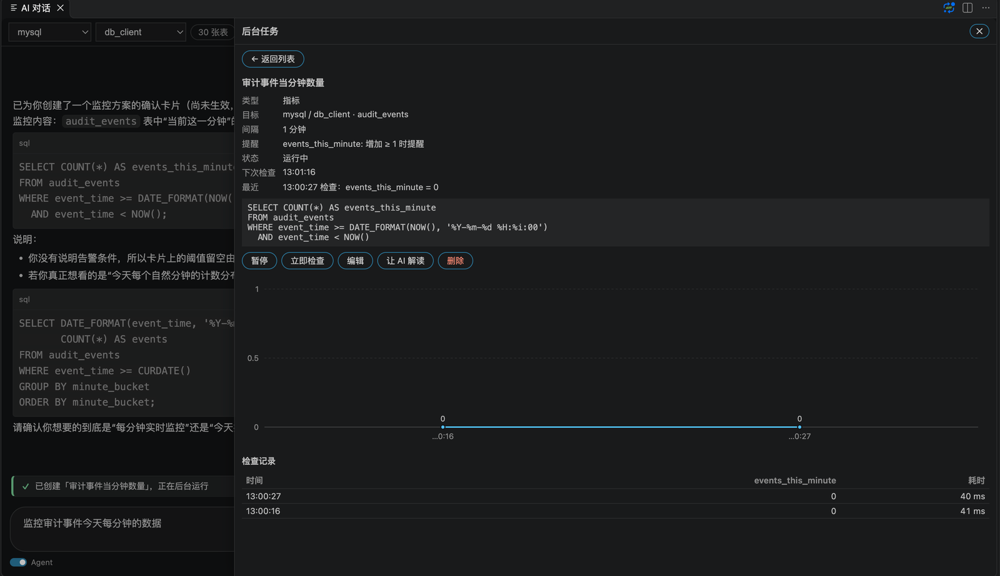
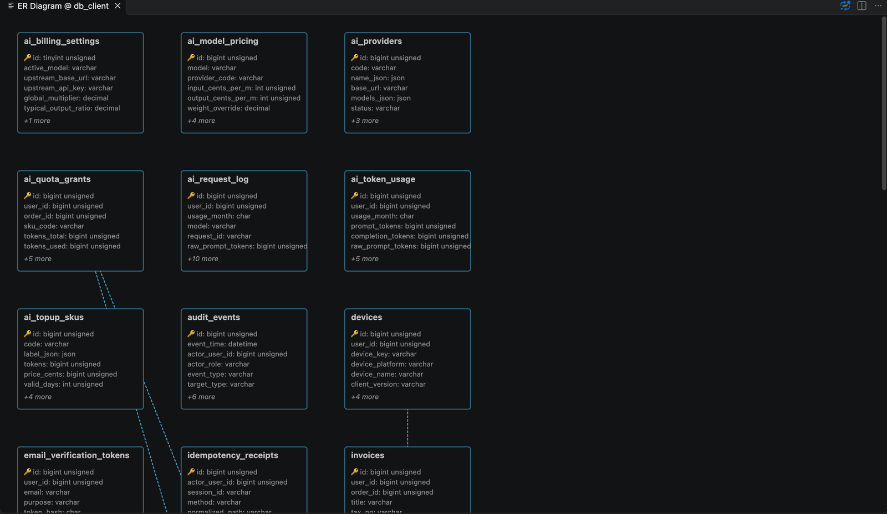
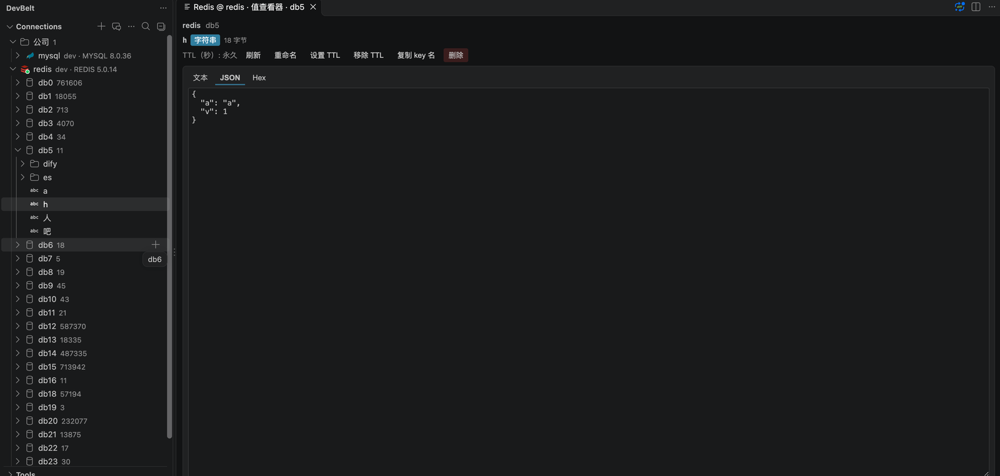
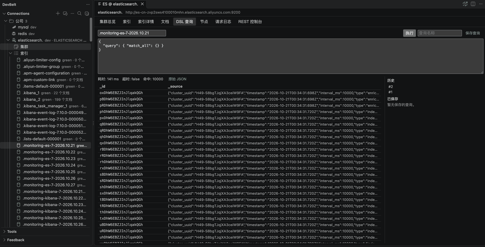
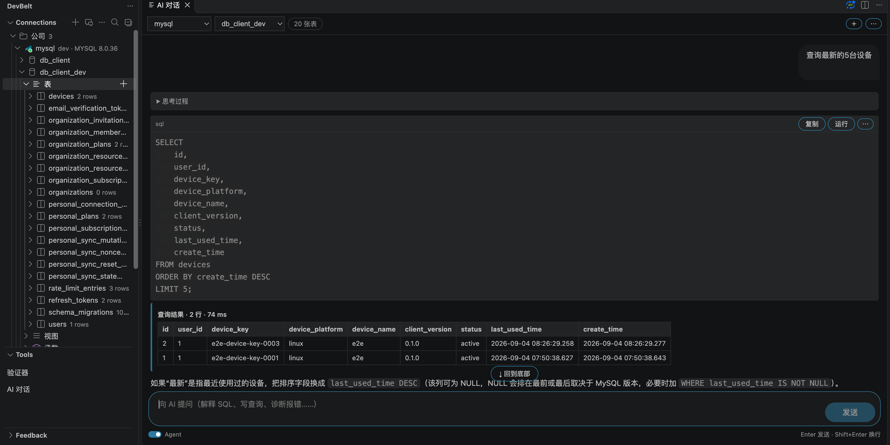

# DevBelt

**在 VS Code 内完成数据库开发。**

DevBelt 将 SQL、Redis、Elasticsearch 与 AI 工作流整合到同一个 VS Code 工作区。浏览连接、编写并执行查询、编辑结果、查看结构、诊断问题，无需在多个数据库工具间切换。

**安装**：[VS Code Marketplace](https://marketplace.visualstudio.com/items?itemName=lang2hong.devbelt-db-client) · [Open VSX](https://open-vsx.org/extension/lang2hong/devbelt-db-client) · [下载 VSIX](https://github.com/lang2hong/devbelt/releases/latest)

[English](https://github.com/lang2hong/devbelt/blob/main/README.en.md) · [更新日志](https://github.com/lang2hong/devbelt/blob/main/CHANGELOG.md)

## 为什么选择 DevBelt

- **一个工作区，多种引擎。** MySQL、PostgreSQL、SQLite、Redis、Elasticsearch 共用统一的工作区、页签模型与安全模型。
- **从查询到结果。** 执行当前语句或选中 SQL、取消长查询、查看执行计划、编辑结果行并导出数据。
- **结构设计是一等能力。** 表设计器、DDL、ER 图、Schema 对比，以及 PostgreSQL 多 schema、多库导航。
- **AI 融入工作流。** 生成 SQL、解释与优化、错误诊断、基于结果样本的数据问答和结果可视化。
- **安全内建。** 凭据保存在系统安全存储；SSH 隧道校验主机密钥；只读与生产保护默认阻止危险操作；写操作进入审计。
- **个人数据端到端加密。** 可选同步连接与分组、保存的查询与文件夹、表/列注记、验证器条目和 AI 模型接入配置；服务端只存密文。
- **按账号隔离。** 数据和凭据按登录账号隔离存储，切换账号时面板会重新加载。

## SQL 工作台

- 连接分组、连接测试与 SSH 隧道。
- SQL 编辑、上下文补全、格式化、执行与取消。
- 编辑器内 `EXPLAIN`。
- 多结果表格、筛选排序、分页与受控行内编辑。
- 查询历史、审计日志、定时备份、服务器仪表盘与对象搜索。
- CSV、JSON、XML、XLSX、SQL 导入导出与库间数据传输。

## 查询洞察

- **可视化 EXPLAIN**：支持 MySQL、PostgreSQL、SQLite，提供计划树、节点详情、告警高亮与原始计划复制。只做规划，不执行语句。
- **AI 解释计划**：把精简后的计划摘要发给 AI Chat 解释。
- **索引建议**：针对有告警的表给出组合列、置信度、理由与风险，可复制 DDL，不会自动执行。
- **慢查询分析**：按 SQL 模板聚合本地查询历史，支持按耗时或次数排序。
- **SQL 诊断**：提示缺少 `WHERE` 的 `UPDATE`/`DELETE`、`DROP`/`TRUNCATE`/`ALTER`、`NOT IN (子查询)` 等风险写法。
- **数据字典**：导出 Markdown 或 HTML，不包含连接信息。

## 监控

- **定时只读检查**：行数、数值指标或新增行；命中条件时弹 VS Code 通知。
- **只提出、不创建**：Agent 只能以卡片形式提出任务，由你确认间隔和提醒条件。
- **后台任务**：图表、检查记录、下次检查、失败次数，间隔和条件可编辑。

## 结构与数据

- 表设计器与 DDL 生成。
- ER 图、Schema 对比与同步 SQL。
- PostgreSQL 多 schema 写入、DDL、导出与数据编辑。
- PostgreSQL 多库浏览，按库懒建会话。
- 备份/恢复与模拟数据生成。

## Redis

- 单机、Cluster、Sentinel 连接，支持 SSH 隧道与 TLS。
- 键浏览器、分隔符折叠、SCAN 分页与二进制安全键。
- string、hash、list、set、zset、Stream 原生编辑。
- Stream 消费组、pending 明细、`XACK` 与 `XCLAIM`。
- CLI 控制台、命令日志、慢日志与服务器状态。
- 只读模式与危险命令确认。

## Elasticsearch

- HTTP/HTTPS、Basic/API Key、TLS 与 SSH 隧道。
- 集群总览、节点列表与索引浏览。
- mapping、settings、aliases 查看。
- 文档分页浏览、创建、编辑、删除与批量删除。
- DSL 控制台与 REST 控制台，结构化错误与在途请求取消。
- 只读 fail-closed 与审计日志。

## AI 助手

- AI Chat 流式回复、会话历史与 Schema 上下文。
- 自然语言生成 SQL、SQL 解释与优化、错误诊断。
- 数据问答，样本发送需显式确认。
- 表设计生成与审阅。
- 结果图表：柱状图、折线图、面积图、饼图、堆叠柱状图、横向条形图。
- 每条回复显示积分消耗、耗时与触发时间。
- SQL 行内补全（默认关闭，按 `Alt+/` 触发）。
- 支持服务端代理或自带 API Key。
- **Agent 模式**（默认关闭）：逐步查结构、跑只读 SQL 与普通 `EXPLAIN`，受步数、工具次数与时间预算限制。
- **写操作只能提出**：DML / DDL 先给出方案，只有你在原生弹窗中批准后才会执行。
- **AI 对话入口**：DevBelt 侧栏标题、状态栏，以及查询结果面板的 `✦ AI` 按钮。

## 同步、安全与审计

- 个人连接同步端到端加密，服务端只保存密文。
- 自动同步默认关闭，可手动同步 / 拉取 / 推送，或显式开启。
- SSH 主机密钥校验：默认首次确认指纹，`strict` 模式只信任 `known_hosts`；密钥变更一律硬失败。
- 凭据保存在系统安全存储。
- 只读模式、生产保护与写操作审计。
- 验证器（2FA/TOTP）密钥保存在操作系统密钥库。

## 快速开始

1. 在 VS Code 扩展市场安装 DevBelt。
2. 打开 DevBelt 活动栏，新建连接。
3. 测试连接，打开 SQL 编辑器或浏览数据。

## 快捷键

| 快捷键 | macOS | 操作 |
|---|---|---|
| `Ctrl+Enter` | `Cmd+Enter` | 运行查询或当前语句 |
| `Ctrl+Alt+Enter` | `Cmd+Ctrl+Enter` | 在新面板运行 |
| `Ctrl+Shift+Enter` | `Cmd+Shift+Enter` | 运行全部语句 |
| `Ctrl+Shift+E` | `Cmd+Shift+E` | EXPLAIN |
| `Alt+A` | — | NL2SQL（在 SQL 编辑器中用自然语言生成 SQL） |
| `Alt+/` | — | 行内 SQL 补全（启用时） |
| `Ctrl+Alt+F` | `Cmd+Alt+F` | 搜索数据库对象 |
| `Ctrl+Alt+C` | `Cmd+Alt+C` | 搜索连接 |

## 系统要求

- VS Code **1.85.0** 或更高版本。
- 支持 MySQL、PostgreSQL、SQL Server、SQLite、Redis、Elasticsearch。

| 引擎 | 支持的版本 | 说明 |
|---|---|---|
| MySQL | 8.0 及以上 | 5.7 及更早版本未验证 |
| PostgreSQL | 11 及以上 | 需要 `pg_get_function_identity_arguments` 与索引 `INCLUDE` |
| SQL Server | 2016 SP1 及以上 | 需要 `CREATE OR ALTER` |
| SQLite | 3.x | 使用系统或内置 `sqlite3` |
| Redis | 6.0 及以上 | 集群/哨兵需对应服务端配置 |
| Elasticsearch | 6.0 及以上 | 6/8/9 已验证；6.x 使用带类型 mapping，也支持 |

低于下限仍可连接，扩展会提示一次版本不受支持，便于你判断功能异常的来源。
- SQLite：Windows 已内置 sqlite3 引擎；macOS/Linux 使用系统 sqlite3（缺失时连接表单会提示安装，或指定命令路径）。

## 隐私与遥测

DevBelt 只发送低频安装/活跃心跳（可在设置中关闭）；登录时安装 ID 会与服务端账号关联用于统计。完整的数据项、账号关联与保留说明见 [遥测与隐私](https://github.com/lang2hong/devbelt/blob/main/docs/遥测与隐私.md)。

## 反馈

在 VS Code 侧边栏打开「反馈」即可提交问题、功能建议或截图；也可以直接到 [GitHub Issues](https://github.com/lang2hong/devbelt/issues) 反馈。反馈无需登录，登录后提交会关联到你的账号。

更多信息：[产品介绍](https://github.com/lang2hong/devbelt) · [更新日志](https://github.com/lang2hong/devbelt/blob/main/CHANGELOG.md)

## 许可

MIT
