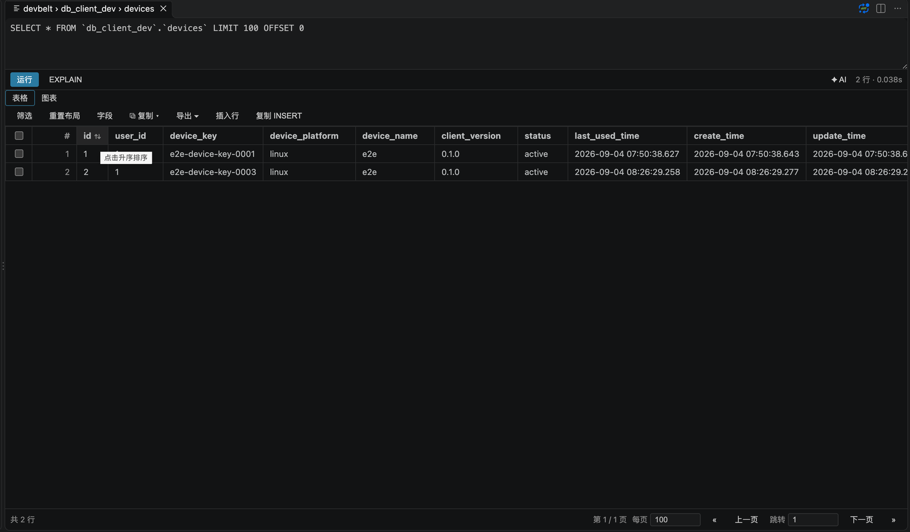
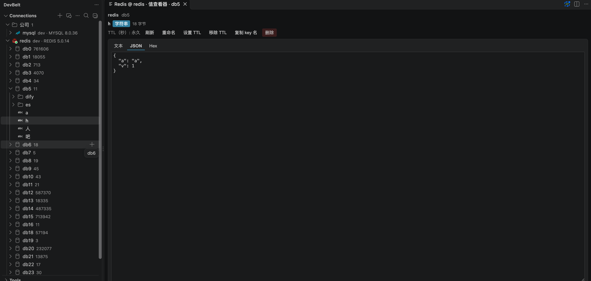
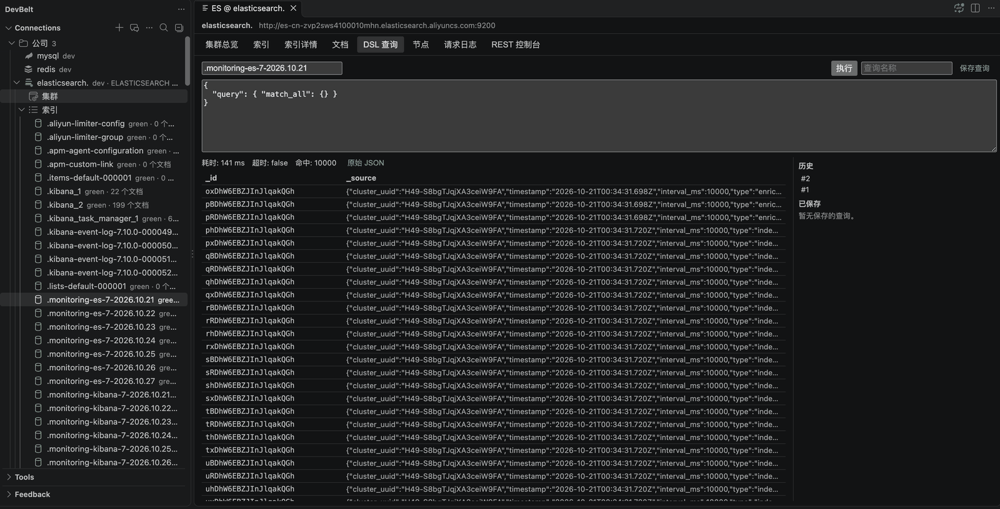
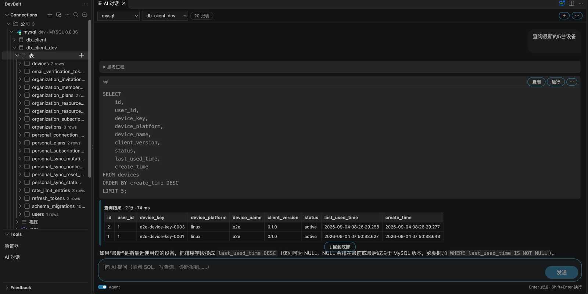

# DevBelt

**Database development, without leaving VS Code.**

[English](#english) · [中文](#中文)


DevBelt brings SQL, Redis, Elasticsearch and AI-assisted workflows into one VS Code workspace. Browse connections, write and run queries, edit results, inspect schemas, and diagnose problems without switching between database tools.

DevBelt 将 SQL、Redis、Elasticsearch 与 AI 工作流整合到同一个 VS Code 工作区。浏览连接、编写并执行查询、编辑结果、查看结构、诊断问题，无需在多个数据库工具间切换。

## Screenshots

> The screenshot slots below are reserved for the final Marketplace assets. Replace the referenced files with real captures before publishing.
>
> 以下截图位为 Marketplace 最终素材预留位置，发布前请替换为真实截图。

### SQL workbench / SQL 工作台



Write, run, inspect and export from one editor. / 在一个编辑器里完成编写、执行、检查与导出。

### Schema design / 结构设计


Design tables, inspect DDL, compare schemas and export ER diagrams. / 设计表、查看 DDL、对比 Schema、导出 ER 图。

### Redis / Redis 工作台



Browse keys, edit native types, inspect Streams and use the CLI console. / 浏览键、编辑原生类型、查看 Stream、使用命令行控制台。

### Elasticsearch / Elasticsearch 工作台



Explore indices, query with DSL and work with documents and REST requests. / 浏览索引、使用 DSL 查询、处理文档与 REST 请求。

### AI assistant / AI 助手



Ask in natural language, explain or optimize SQL, and turn results into charts. / 用自然语言提问、解释或优化 SQL，并把结果转成图表。

### Sync and security / 同步与安全


E2EE personal sync, SSH host-key verification, read-only protection and audit logs. / 端到端加密个人同步、SSH 主机密钥校验、只读保护与审计日志。

## English

### Why DevBelt

- **One workspace, multiple engines.** MySQL, PostgreSQL, SQLite, Redis and Elasticsearch share the same workspace, tab model and security model.
- **From query to result.** Run the current statement or selection, cancel long queries, inspect plans, edit result rows and export data.
- **Schema work is first-class.** Table designer, DDL, ER diagrams, schema comparison and PostgreSQL multi-schema/multi-database navigation.
- **AI is part of the workflow.** Generate SQL, explain and optimize queries, diagnose errors, ask questions about result samples and visualize results.
- **Security is built in.** Secrets stay in VS Code `SecretStorage`; SSH tunnels use host-key verification; read-only and production guards are fail-closed; writes are audited.
- **Personal connections stay personal.** Optional E2EE sync protects connection metadata and local paths before they leave the device.

### SQL workspace

- Connection groups, connection testing and SSH tunnels.
- SQL editing, context-aware completion, formatting, execution and cancellation.
- `EXPLAIN` from the editor.
- Multi-result grids with filters, sorting, paging and controlled inline editing.
- Query history, audit log, scheduled backups, server dashboard and object search.
- CSV, JSON, XML, XLSX and SQL import/export; database-to-database transfer.

### Schema and data

- Table designer and DDL generation.
- ER diagrams and schema comparison with synchronization SQL.
- PostgreSQL multi-schema writes, DDL, export and data editing with schema-qualified names.
- PostgreSQL multi-database navigation with lazy per-database sessions.
- Backup/restore and mock-data generation.

### Redis

- Standalone, Cluster and Sentinel connections, including SSH tunnels and TLS.
- Key browser with separators, SCAN paging and binary-safe keys.
- Native editors for all core data types: strings, hashes, lists, sets, sorted sets and Streams.
- Stream consumer-group details, pending entries, `XACK` and `XCLAIM`.
- CLI console, command log, slow log and server status.
- Read-only mode and dangerous-command confirmation.

### Elasticsearch

- HTTP/HTTPS, Basic/API-key authentication, TLS and SSH tunnels.
- Cluster overview, node list and index browser.
- Mapping, settings and aliases inspection.
- Document browsing with `search_after` pagination; create, edit, delete and bulk delete.
- DSL console with result paging and structured result tables.
- REST console with structured errors, truncation notices and in-flight request cancellation.
- Fail-closed read-only enforcement and audit logging.

### AI assistant

- AI Chat with streaming responses, conversation history and schema context.
- Natural-language to SQL, SQL explanation and optimization, and error diagnosis.
- Data Q&A with sample sending explicitly opt-in.
- Table design generation and review.
- Result charts: bar, line, area, pie, stacked bar and horizontal bar.
- Per-response credits used, duration and trigger time.
- Inline SQL completion (off by default, trigger with `Alt+/`).
- Server proxy or bring-your-own API key.
- AI preferences and custom rules sync across devices with end-to-end encryption.

### Sync, security and audit

- Personal connection sync is end-to-end encrypted; the server stores ciphertext only.
- Auto sync is **off by default** (`devbelt.sync.autoSync`); use Sync Now / Pull / Push or enable it explicitly.
- SSH host-key verification:
  - `tofu` (default): confirm the SHA256 fingerprint for a new host, then trust it.
  - `strict`: only trust hosts already present in `known_hosts`.
  - Key changes and `@revoked` always fail closed.
- Credentials live in VS Code `SecretStorage`.
- Read-only mode, production guards and audit records for writes.
- Authenticator (2FA/TOTP) with secrets kept in the OS keychain.

### Get started

1. Install DevBelt from the VS Code Marketplace.
2. Open the DevBelt activity bar and create a connection.
3. Test the connection, open a SQL editor or browse data.
4. Optionally sign in and enable encrypted personal sync.

```bash
code --install-extension lang2hong.devbelt-db-client
```

### Shortcuts

| Shortcut | macOS | Action |
|---|---|---|
| `Ctrl+Enter` | `Cmd+Enter` | Run query or current statement |
| `Ctrl+Alt+Enter` | `Cmd+Ctrl+Enter` | Run in a new panel |
| `Ctrl+Shift+E` | `Cmd+Shift+E` | EXPLAIN |
| `Ctrl+Alt+F` | `Cmd+Alt+F` | Search database objects |
| `Ctrl+Alt+C` | `Cmd+Alt+C` | Search connections |

### Requirements and status

- VS Code **1.85.0** or newer.
- The local SQL path (MySQL, PostgreSQL, SQLite) is the most mature part of the product.
- Redis, Elasticsearch and AI features are available and continue to receive real-world hardening.
- Personal sync is E2EE and opt-in; dual-device installed-build validation is pending.

### Documentation

- [Product overview](https://github.com/lang2hong/vscode-db-client)
- [Documentation center](https://github.com/lang2hong/vscode-db-client/tree/main/docs)
- [Issues](https://github.com/lang2hong/vscode-db-client/issues)

## 中文

### 为什么选择 DevBelt

- **一个工作区，多种引擎。** MySQL、PostgreSQL、SQLite、Redis、Elasticsearch 共用统一的工作区、页签模型与安全模型。
- **从查询到结果。** 执行当前语句或选中 SQL、取消长查询、查看执行计划、编辑结果行并导出数据。
- **结构设计是一等能力。** 表设计器、DDL、ER 图、Schema 对比，以及 PostgreSQL 多 schema、多库导航。
- **AI 融入工作流。** 生成 SQL、解释与优化、错误诊断、基于结果样本的数据问答和结果可视化。
- **安全内建。** 凭据保存在 VS Code `SecretStorage`；SSH 隧道校验主机密钥；只读与生产保护默认 fail-closed；写操作进入审计。
- **个人连接保持私密。** 可选端到端加密同步，连接元数据与本地路径在离开设备前完成加密。

### SQL 工作台

- 连接分组、连接测试与 SSH 隧道。
- SQL 编辑、上下文补全、格式化、执行与取消。
- 编辑器内 `EXPLAIN`。
- 多结果表格、筛选排序、分页与受控行内编辑。
- 查询历史、审计日志、定时备份、服务器仪表盘与对象搜索。
- CSV、JSON、XML、XLSX、SQL 导入导出与库间数据传输。

### 结构与数据

- 表设计器与 DDL 生成。
- ER 图、Schema 对比与同步 SQL。
- PostgreSQL 多 schema 写入、DDL、导出与数据编辑，对象名按 schema 限定。
- PostgreSQL 多库浏览，按库懒建会话。
- 备份/恢复与模拟数据生成。

### Redis

- 单机、Cluster、Sentinel 连接，支持 SSH 隧道与 TLS。
- 键浏览器、分隔符折叠、SCAN 分页与二进制安全键。
- 全部核心数据类型原生编辑：string、hash、list、set、zset、Stream。
- Stream 消费组、pending 明细、`XACK` 与 `XCLAIM`。
- CLI 控制台、命令日志、慢日志与服务器状态。
- 只读模式与危险命令确认。

### Elasticsearch

- HTTP/HTTPS、Basic/API Key、TLS 与 SSH 隧道。
- 集群总览、节点列表与索引浏览。
- mapping、settings、aliases 查看。
- 文档 `search_after` 分页浏览，创建、编辑、删除与批量删除。
- DSL 控制台，结果分页并结构化展示。
- REST 控制台，结构化错误、截断提示与在途请求取消。
- 只读 fail-closed 与审计日志。

### AI 助手

- AI Chat 流式回复、会话历史与 Schema 上下文。
- 自然语言生成 SQL、SQL 解释与优化、错误诊断。
- 数据问答，样本发送需显式确认。
- 表设计生成与审阅。
- 结果图表：柱状图、折线图、面积图、饼图、堆叠柱状图、横向条形图。
- 每条回复显示积分消耗、耗时与触发时间。
- SQL 行内补全（默认关闭，按 `Alt+/` 触发）。
- 支持服务端代理或自带 API Key。
- AI 偏好与自定义规则端到端加密跨设备同步。

### 同步、安全与审计

- 个人连接同步端到端加密，服务端只保存密文。
- 自动同步**默认关闭**（`devbelt.sync.autoSync`）；可手动立即同步 / 拉取 / 推送，或显式开启。
- SSH 主机密钥校验：
  - `tofu`（默认）：首次连接确认 SHA256 指纹，接受后信任。
  - `strict`：只信任 `known_hosts` 中已有主机。
  - 密钥变更或 `@revoked` 一律硬失败。
- 凭据保存在 VS Code `SecretStorage`。
- 只读模式、生产保护与写操作审计。
- 验证器（2FA/TOTP）密钥保存在操作系统密钥库。

### 快速开始

1. 从 VS Code 插件市场安装 DevBelt。
2. 打开 DevBelt 活动栏，新建连接。
3. 测试连接，打开 SQL 编辑器或浏览数据。
4. 如需跨设备同步，登录并启用端到端加密个人同步。

```bash
code --install-extension lang2hong.devbelt-db-client
```

### 快捷键

| 快捷键 | macOS | 操作 |
|---|---|---|
| `Ctrl+Enter` | `Cmd+Enter` | 运行查询或当前语句 |
| `Ctrl+Alt+Enter` | `Cmd+Ctrl+Enter` | 在新面板运行 |
| `Ctrl+Shift+E` | `Cmd+Shift+E` | EXPLAIN |
| `Ctrl+Alt+F` | `Cmd+Alt+F` | 搜索数据库对象 |
| `Ctrl+Alt+C` | `Cmd+Alt+C` | 搜索连接 |

### 要求与状态

- 需要 VS Code **1.85.0** 或更高版本。
- 本地 SQL 路径（MySQL、PostgreSQL、SQLite）是当前最成熟的部分。
- Redis、Elasticsearch 与 AI 能力已可用，仍在持续进行真机硬化。
- 个人同步为端到端加密、可选启用；双设备安装版验证仍在进行。

### 文档

- [产品介绍](https://github.com/lang2hong/vscode-db-client)
- [文档中心](https://github.com/lang2hong/vscode-db-client/tree/main/docs)
- [问题反馈](https://github.com/lang2hong/vscode-db-client/issues)

## License / 许可

MIT